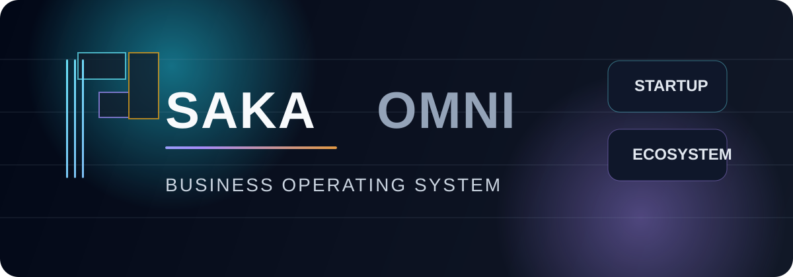

# SAKA OMNI

<div align="center">
  
</div>

<p align="center">
  <strong>Futuristic Business Ecosystem</strong><br>
  <em>Build, automate, and scale the next generation of business</em>
</p>

<div align="center">
  
</div>

<div align="center">
  
  
  
  
</div>

---

## Indonesia

SAKA OMNI adalah platform digital yang dirancang untuk membantu bisnis modern membangun ekosistem operasional yang kuat, cepat, dan scalable. Kami menghadirkan pendekatan satu platform yang mengintegrasikan website, commerce, automation, analitik, dan layanan pelanggan dalam satu pengalaman yang terhubung.

### Visi
Menyediakan sistem operasional digital yang memungkinkan bisnis berpindah dari alat yang terpisah menjadi satu platform yang terintegrasi, efisien, dan siap tumbuh.

### Apa yang kami bangun
- Landing page startup premium dan futuristik
- Sistem layanan digital dan positioning brand
- Alur conversion yang siap dimanfaatkan untuk lead generation
- Form kontak profesional yang terhubung ke SMTP email backend
- Struktur front-end yang mudah dikembangkan dan diadaptasi

### Pilar platform
| Pilar | Deskripsi |
| --- | --- |
| Website & Storefront | Menyediakan presence online yang modern, cepat, dan konsisten dengan brand |
| Growth & Analytics | Mengukur performa funnel, trafik, dan efektivitas campaign secara real-time |
| Automation Engine | Mengotomatiskan proses operasional dan customer workflow sehari-hari |
| Security & Compliance | Menjaga data dan bisnis tetap aman, terstruktur, dan siap scale |

### Struktur project
```text
.
├── index.html
├── styles.css
├── script.js
├── i18n.js
├── privacy.html
├── terms.html
├── LICENSE
├── assets/
│   ├── logo-mark.svg
│   └── cover-banner.svg
├── mail/
│   ├── config.php
│   ├── send-mail.php
│   ├── smtp-mailer.php
│   ├── README-SMTP.md
│   ├── .htaccess
│   └── x.txt
└── README.md
```

### Stack teknologi
- HTML5
- CSS3
- JavaScript
- PHP

### Cara pengembangan lokal
```bash
git clone https://github.com/mlevdev364-dev/web.git
cd web
php -S localhost:8000
```
Lalu buka:
```text
http://localhost:8000
```

### Deployment
Project ini cocok untuk server yang mendukung PHP. Form kontak pada website membutuhkan backend agar email dapat dikirim secara aman melalui SMTP.

Untuk deployment produksi:
1. Upload seluruh project ke hosting yang mendukung PHP
2. Pastikan folder `mail/` tetap ada di root project
3. Edit konfigurasi SMTP di `mail/config.php`
4. Gunakan App Password untuk Gmail / akun SMTP yang mewajibkan autentikasi ekstra

> Catatan penting: GitHub Pages tidak mendukung eksekusi PHP, sehingga form kontak tidak bisa berfungsi pada hosting statis murni.

### Konfigurasi SMTP
Konfigurasi email tersedia di:
- `mail/config.php`
- `mail/send-mail.php`
- `mail/smtp-mailer.php`

Panduan lengkap tersedia di:
- `mail/README-SMTP.md`

### Keunggulan produk
- Desain premium untuk brand teknologi dan startup
- Fitur multi-bahasa Indonesia/English
- Lebih siap untuk portfolio, client presentation, atau pitch ke investor
- Mudah diperluas menjadi landing page produk atau platform SaaS

---

## English

SAKA OMNI is a digital platform designed to help modern businesses build a stronger, faster, and more scalable operational ecosystem. We bring a single-platform approach that connects website presence, commerce, automation, analytics, and customer support into one cohesive experience.

### Vision
To provide a digital operating system that helps businesses move from disconnected tools to a unified, efficient, and growth-ready platform.

### What we build
- Premium startup landing page with a futuristic visual direction
- Digital service positioning and brand communication system
- Conversion-ready experience for lead generation and outreach
- Professional contact flow connected to an SMTP email backend
- Front-end structure that is easy to extend and adapt

### Platform pillars
| Pillar | Description |
| --- | --- |
| Website & Storefront | Deliver a modern, fast, and on-brand online presence |
| Growth & Analytics | Measure campaign performance, traffic, and conversion in real time |
| Automation Engine | Streamline daily operations and customer workflows |
| Security & Compliance | Protect business data with a more structured and scalable foundation |

### Project structure
```text
.
├── index.html
├── styles.css
├── script.js
├── i18n.js
├── privacy.html
├── terms.html
├── LICENSE
├── assets/
│   ├── logo-mark.svg
│   └── cover-banner.svg
├── mail/
│   ├── config.php
│   ├── send-mail.php
│   ├── smtp-mailer.php
│   ├── README-SMTP.md
│   ├── .htaccess
│   └── x.txt
└── README.md
```

### Tech stack
- HTML5
- CSS3
- JavaScript
- PHP

### Local development
```bash
git clone https://github.com/mlevdev364-dev/web.git
cd web
php -S localhost:8000
```
Open in browser:
```text
http://localhost:8000
```

### Production deployment
This project is well suited for PHP-enabled hosting because the contact form requires backend processing to send messages securely via SMTP.

For production deployment:
1. Upload the project to a PHP-capable hosting provider
2. Ensure the `mail/` folder is preserved in the project root
3. Update SMTP credentials in `mail/config.php`
4. Use an App Password for Gmail or any provider requiring additional authentication

> Important: GitHub Pages does not execute PHP, so the contact form will not function on a purely static hosting setup.

### SMTP configuration
Email configuration is available in:
- `mail/config.php`
- `mail/send-mail.php`
- `mail/smtp-mailer.php`

Full instructions are available here:
- `mail/README-SMTP.md`

### Product advantages
- Premium design suitable for technology and startup positioning
- Multi-language support for Indonesian and English
- Ready for portfolio use, client presentations, or investor-facing storytelling
- Easy to extend into a SaaS product landing page or full digital platform

---

## Why SAKA OMNI
SAKA OMNI is built to represent a clear business narrative: modern companies need a system that brings clarity, speed, and scale into one digital experience. This project is designed to communicate that value immediately through visual storytelling and strategic positioning.

## Contact
- Email: hello@saka-ai.my.id
- WhatsApp: +62 851-1133-0391

## License
This project is licensed under the MIT License. See the `LICENSE` file for details.

## Brand statement
SAKA OMNI is a future-focused business ecosystem designed for founders, operators, and teams building the next generation of digital growth.
